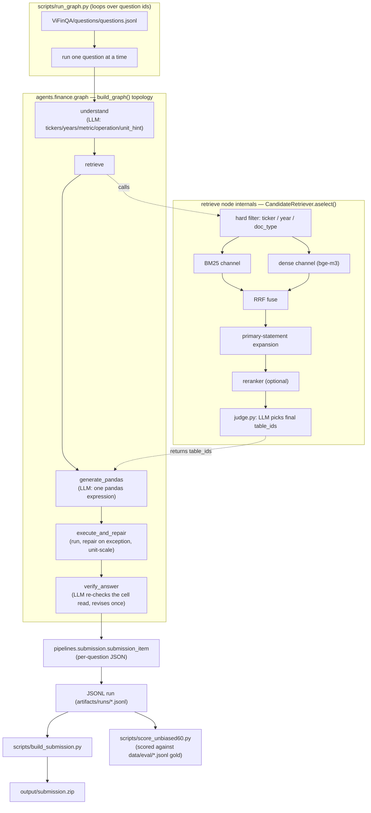

# ViFinQA Stage 2

Finance QA pipeline for selecting financial-statement tables, loading normalized
CSV evidence, solving numeric questions, and packaging leaderboard submissions.

For operational cautions, benchmark notes, and current next work, read
[`docs/HANDOFF.md`](docs/HANDOFF.md).

## Current Status

- Corpus snapshot: 146,246 tables from 1,973 OCR files and 1,012 enriched questions.
- Interactive and batch flows both run the same graph: `finance_qa.agents.finance.run_question`
  for one question, `scripts/run_graph.py` to drive it over many and write a submission-ready
  JSONL, packaged by `scripts/build_submission.py`.
- Core code is organized as modules and services. The graph's nodes and topology live in
  `agents.finance.graph`; pipelines compose that graph (or module service APIs) into a runnable
  job instead of importing implementation internals directly.
- Deterministic tests cover numeric normalization, header repair, retrieval candidate policy,
  and the solve_qa codegen/execute/verify units.

## Setup

**Environment.** Use a dedicated virtualenv (`.venv_bge` in the commands below), not the base
conda env: the base env's `torch` build (cu130) cannot see the GPU against this machine's
CUDA-12.6 driver, and `torch`/`transformers` are what run the local bge-m3 dense embedder.

```bash
python3 -m venv .venv_bge
.venv_bge/bin/pip install -e .
# GPU acceleration matching the pinned torch version (optional -- falls back to CPU
# automatically if no CUDA device is visible, see modules/rag/indexing/dense.py):
.venv_bge/bin/pip install torch==2.7.1 --index-url https://download.pytorch.org/whl/cu126
```

**Required inputs not in git** (see `.gitignore` — unrebuildable / too large for a repo):

- `ViFinQA/` — the raw dataset: `financial_statements/*_extracted.txt` (OCR text),
  `questions/questions.jsonl`, `code_stock.csv`. Must be placed at the repo root.
- `data/metadata/tables_metadata_v2.jsonl`, `data/indexes/tables_doc_text.parquet`,
  `data/indexes/tables_dense.npy` — protected derived artifacts (`docs/DECISIONS.md` section 8).
  The bge-m3 dense index cannot currently be rebuilt from scratch (its v1 metadata source no
  longer exists on disk), so these three must be copied in from a backup rather than regenerated.
  Download link and per-file schema: [`docs/DATA.md`](docs/DATA.md).
- `data/eval/*.jsonl` (gold questions) — these ARE tracked in git (`!data/eval/` in
  `.gitignore`), nothing to provide.

**LLM backend.** Every node except `retrieve`'s BM25/dense scoring calls out to a chat model
over the OpenAI-compatible endpoint in `core/llm.py`. Point it at either:

```bash
# a local vLLM server serving Qwen3.5-9B (default LLM_MODEL if unset):
export LLM_ENDPOINT=http://127.0.0.1:8990/v1/chat/completions
export LLM_MODEL=Qwen/Qwen3.5-9B

# or a hosted backend (no local server needed):
export LLM_ENDPOINT=https://api.deepinfra.com/v1/openai/chat/completions
export LLM_MODEL=Qwen/Qwen3-14B
export LLM_API_KEY=$DEEPINFRA_API_KEY
```

## Reproducing A Run

With the inputs above in place:

```bash
# 1. (only if data/indexes/* are missing) rebuild derived data from the raw dataset:
PYTHONPATH=src .venv_bge/bin/python scripts/build_data_pipeline.py

# 2. run the graph over questions, writing one JSONL record per question:
PYTHONPATH=src .venv_bge/bin/python scripts/run_graph.py --all --out artifacts/runs/full_run.jsonl

# 3. score against the honest gold set (73 questions, see docs/HANDOFF.md):
PYTHONPATH=src .venv_bge/bin/python scripts/score_unbiased60.py --run solve=artifacts/runs/full_run.jsonl --right solve

# 4. (only for runs produced before the cellexpr fix) rewrite the fact solvers'
#    hardcoded pandas_query into a real cell read. On a run from the current code it
#    reports `{}`, because the solvers now decline instead of emitting a constant:
PYTHONPATH=src .venv_bge/bin/python scripts/repair_fact_queries.py \
    artifacts/runs/full_run.jsonl artifacts/runs/full_run_repaired.jsonl

# 5. re-locate cell reads whose row index and column name belong to the pre-merge frame:
PYTHONPATH=src .venv_bge/bin/python scripts/repair_cell_indices.py \
    artifacts/runs/full_run_repaired.jsonl artifacts/runs/full_run_cells.jsonl

# 6. (optional, needs step 2 run more than once) fill the certainly-wrong cells of one
#    run from the others:
PYTHONPATH=src .venv_bge/bin/python scripts/fill_from_arms.py \
    artifacts/runs/full_run_cells.jsonl artifacts/runs/full_run_filled.jsonl \
    artifacts/runs/full_run_2_cells.jsonl artifacts/runs/full_run_3_cells.jsonl

# 7. rescale answers that fall below the floor of the unit they were asked in:
PYTHONPATH=src .venv_bge/bin/python scripts/rescale_below_floor.py \
    artifacts/runs/full_run_filled.jsonl artifacts/runs/full_run_rescaled.jsonl

# 8. re-count the counting questions, which the units pass scaled as if they had a unit:
PYTHONPATH=src .venv_bge/bin/python scripts/recount_saturated.py \
    artifacts/runs/full_run_rescaled.jsonl artifacts/runs/full_run_recounted.jsonl

# 9. let the "năm nào" questions pick their year from the data instead of a constant:
PYTHONPATH=src .venv_bge/bin/python scripts/deliteralize_years.py \
    artifacts/runs/full_run_recounted.jsonl artifacts/runs/full_run_years.jsonl

# 10. package a leaderboard submission. `--no-literal-on-error` is required: without it
#     a query that fails to execute is replaced by `repr(answer)`, which is the hardcoded
#     shape the rules score as zero.
PYTHONPATH=src .venv_bge/bin/python scripts/build_submission.py --run artifacts/runs/full_run_years.jsonl --out output/submission --no-literal-on-error
```

Steps 4 to 9 are post-processing passes, not solvers, so they sit between `run_graph.py` and
`build_submission.py` rather than inside `modules/solve/`. Each docstring carries the full
rationale and the pre-registered bar it was measured against. Skipping step 7 costs roughly
1.6 leaderboard points.

Step 8 is only needed for runs recorded before `is_count_query` landed in
`modules/solve/codegen/execute.py`. It has to run after step 7 and before step 10: step 7 writes
the scale factor this undoes, and step 10 wraps `pandas_query` in `round(float(...), 2)`, which
puts the factor inside a wrapper `strip_scale_factor` cannot reach.

Step 9 is a compliance repair for a bug in this repo, not in the model. `raw_selection_linker`
and `project_year` used to answer a "năm nào" question with `(<winning cell>) * 0 + <year>`,
which the rules read as a stored result: the `* 0` annihilates the only data the query touches.
The selection those solvers actually performed survives in `diag`, so the step rebuilds it as
`max([(float(<cell 2016>), 2016), ...])[1]` and ships every candidate year's table as evidence.
It only overwrites when the rebuilt query runs on the shipped frames and reproduces the recorded
answer, so it moves no answer and cannot cost execution accuracy. On the v27 run it converts 22
of the 33 such questions; the other 11 came through codegen, which does not record the branches
of its own `max`. It must run before step 10 for the same reason step 8 does.

Both solvers now build that comparison themselves, so the step only matters for runs recorded
before they did. Replaying the 33 affected questions afterwards leaves 2 in the old shape, both
from codegen declining to resolve a branch's year, and step 9 cannot rebuild either -- it needs
`raw_selection_linker`'s `diag`. On a fresh run it is a no-op.

Step 4 is a compliance repair, and it is only needed for runs recorded before
`modules/solve/facts/cellexpr.py` existed. The fact solvers used to compute their answer in
Python from `long_format.parquet` and then write the number itself as `pandas_query`, which
the rules score as zero. It replays the plan stored in each record's `diag` to recover a real
`dfN.iloc[r]["col"]` expression, and only overwrites when the replayed answer matches the
recorded one exactly. Steps 5 to 7 must run after it: they rewrite `answer` or wrap
`pandas_query`, so a replay after them would not match.

Step 5 is the other compliance repair, and it fixes a different failure. A table with a
two-level header is read by the solvers while the leaf tier is still an ordinary data row, so
the recorded row index is one too high and the recorded column name is only the group tier. At
packaging time `load_frame` merges the tiers into `"group | leaf"` and the leaf row leaves the
body, so the query raises `KeyError`. Packaged with `--literal-on-error` that becomes
`repr(answer)`: the answer stays right, the query becomes a constant, and the rules score it
zero. Packaged without it the question simply ships a broken query, which is a wrong answer
rather than a violation. Either way the fix belongs here, in step 5. The
pass re-locates each cell from `diag["profile_validate"]["query_cells"]` by its `row_label` and
`column_index` (for a cell whose label was absorbed into the header it uses the row shift voted
by the labelled cells of the same frame), then re-runs the whole rewritten query and keeps it
only if it reproduces the recorded `answer`. It never writes `answer`, so it cannot move
ANSWER_ACCURACY. On the submitted run it repaired 48 of the 57 broken queries.

Step 6 exists because the pipeline is not deterministic. Same code, same server,
`temperature=0`: two runs disagree on about 30% of answers, because vLLM batches requests
continuously and batch composition changes between runs. So no single run is bit-reproducible,
including the ones already submitted. Step 6 turns that into an advantage by running step 2
several times and replacing only the cells that are wrong on their face (`answer == 0.0`, the
give-up constant; or outside the plausible band of the unit asked for). Measured twice a week
apart against a bar registered in advance, it has never turned a right answer into a wrong one.

`run_graph.py --ids <comma-separated ids>` runs a subset instead of `--all` (see Common Commands
below for a one-question smoke test).

### What the submitted answers came from

The answers in the final submission were recorded on 2026-08-24 and are preserved verbatim at
`artifacts/runs/full1012_v17_unitfix.jsonl`, which already carries the step 7 rescale. The
submission is that file put through steps 4, 5 and 8 above; step 6 was not used. Step 4
rewrote 94 of the 1,012 `pandas_query` values and step 5 re-located 48 broken cell reads.
Neither writes `answer`, so every answer leaves those two steps untouched (1,012 of 1,012
identical). Packaging then rounds to two decimals, which does change 725 of them, and three
answers that arrived as `1e-09` left as `0.0` -- indistinguishable from the give-up constant,
which is how the count bug behind step 8 stayed hidden. That part is deterministic all the
same: re-running the steps on that file reproduces the submitted archive byte for byte
(`v27_cells.jsonl` through step 9 gives sha256 `c778c102...`, the submitted `submission.json`).

Step 2 is not. Because of the batching effect described above, a fresh run of the current code
against a fresh vLLM server lands about three points lower than the recorded run (0.37 rather
than 0.40 answer accuracy), and two fresh runs also differ from each other. The gap is not a
code regression: the header-repair commits landed after 2026-08-24 were checked by diffing
column names for all 9,647 tables between that commit and HEAD, and none changed. The only
uncontrolled variable is the vLLM server configuration in use on 2026-08-24, which was not
recorded. So expect a re-run to reproduce the pipeline and the method, not the exact numbers.

## Repository Layout

```text
src/finance_qa/
  core/                 config, LLM client, filesystem paths, shared types
  modules/
    data/               table loading, metadata, preprocessing
    rag/                candidate retrieval, indexes, retrievers, rerankers, judge
    solve/              grounded pandas codegen, execution/repair, verify
    tools/              DataFrame, numeric, execution utilities
  pipelines/            submission item shape + data pipeline orchestration
  agents/               finance agent state/understand/graph topology/public entrypoints
  evaluation/           reusable evaluation helpers
scripts/                command-line entrypoints and diagnostics
tests/                  deterministic script-style tests
data/                   tables, metadata, indexes, and curated eval data
artifacts/              generated reports and run outputs
output/                 final submission artifacts only
docs/                   current handoff, decisions, and design notes
```

Filesystem defaults live in `src/finance_qa/core/paths.py`.

## Answer Flow

One question runs the same 5-node graph whether called interactively
(`agents.finance.run_question`) or from the batch driver. `retrieve` is one node in the
graph, but internally calls `CandidateRetriever` (`modules/rag/candidates.py`), which is
itself a chain of retrieval steps — `judge.py` is the last of those steps, not a node.



## Common Commands

Use the repository's `.venv_bge` environment and set `PYTHONPATH=src`:

```bash
PYTHONPATH=src .venv_bge/bin/python -m compileall -q src scripts tests
PYTHONPATH=src .venv_bge/bin/python tests/test_query_execution.py
PYTHONPATH=src .venv_bge/bin/python tests/test_candidate_pool.py
PYTHONPATH=src .venv_bge/bin/python tests/test_solve_units.py
PYTHONPATH=src .venv_bge/bin/python tests/test_cell_expression.py
PYTHONPATH=src .venv_bge/bin/python tests/test_understand.py
PYTHONPATH=src .venv_bge/bin/python scripts/run_graph.py --ids 371 --out artifacts/runs/smoke_q371.jsonl
```

Dense retrieval and index rebuild commands require the GPU environment.
Corpus rebuild commands under `scripts/` are CLI wrappers over `src/finance_qa/modules/*`
services. `scripts/extract_tables.py` rewrites corpus artifacts and is not a smoke test.
Most files under `tests/` are run directly as scripts (as above), not collected by
`pytest`; `pytest tests/` raises an INTERNALERROR because some tests call `sys.exit()`
at module level.
