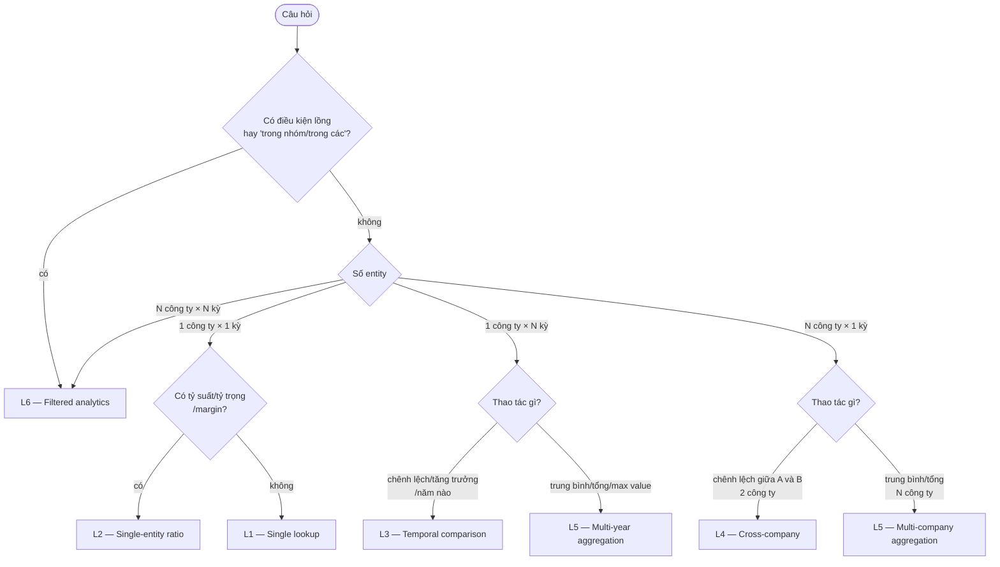

# Phân loại câu hỏi ViFinQA — exploration

> **Mục đích:** hiểu data để chốt luồng, chưa build gì. Sau doc này sẽ tự giải tay ≥6 câu tiêu biểu (1 câu/loại) để rút pattern → làm input cho design storage + RAG.

## 1. Tổng quan

- **1012 câu hỏi** trên **100 ticker**, phạm vi báo cáo tài chính 2015-2025.
- Mỗi câu hỏi kỳ vọng **1 đáp án số học** (float) — không có multiple choice, không có open-ended.
- Trả lời được đòi hỏi 4 bước:
  1. **Locate report(s)** — xác định (ticker, năm, loại BCTC: riêng/hợp nhất/BCTC riêng của ngân hàng…)
  2. **Locate table(s)** — trong báo cáo có nhiều bảng, phải chọn đúng
  3. **Locate cell(s)** — dòng chỉ tiêu × cột kỳ
  4. **Compute** — có thể chỉ là unit conversion, hoặc phép trừ/chia, aggregation, hoặc pipeline lồng
- **Vì sao cần phân loại:** retrieval + computation strategy khác nhau rõ rệt giữa các loại. L1 chỉ cần 1 table + 1 cell; L6 cần LLM plan multi-step.

## 2. Sáu loại câu hỏi (L1..L6)

Định nghĩa dựa trên **hai trục**:
- **Số entity nhắc đến** (công ty × kỳ báo cáo)
- **Loại phép biến đổi** (lookup thô / ratio / delta / aggregation / filtered analytics)

### L1 — Single lookup

1 công ty, 1 kỳ, 1 cell. Không tính toán, chỉ có thể có unit conversion.

Ví dụ:
- **#1**: "Lãi tiền gửi năm 2018 của công ty mẹ CTCP Hàng không Vietjet (VJC) là bao nhiêu triệu đồng?"
- **#7**: "Quỹ khen thưởng, phúc lợi của HT1 cuối năm 2019 là bao nhiêu tỷ đồng?"
- **#100**: "Tổng số lượng cổ phần của Tập đoàn Bảo Việt (BVH) vào cuối năm 2018 là bao nhiêu cổ phần?"

Signals nhận diện:
- Đúng 1 ticker hoặc 1 tên công ty
- Đúng 1 năm hoặc mốc thời gian
- Chỉ tiêu là danh từ trực tiếp ("Lãi tiền gửi", "Số dư …", "Quỹ khen thưởng…")
- Không có từ so sánh / phái sinh

Độ phức tạp: **1 report × 1 table × 1 cell × 0 phép tính (hoặc chỉ unit convert)**.

---

### L2 — Single-entity ratio

1 công ty, 1 kỳ, cần ≥2 cell → tỷ số / margin / percentage.

Ví dụ:
- **#656**: "Tỷ trọng các khoản tương đương tiền trên tổng tài sản của CTCP Viễn thông FPT cuối năm 2024 là bao nhiêu %?"
- **#674**: "Tỷ suất lợi nhuận ròng của HBC năm 2016 là bao nhiêu %?"
- **#712**: "Tỉ trọng chi phí tài chính trên doanh thu thuần của CTCP Điện Gia Lai năm 2025 là bao nhiêu (%)"

Signals: `tỷ suất`, `tỷ trọng`, `biên lợi nhuận`, `X trên Y`, `ROE / ROA / hệ số`, `%` (nhưng KHÔNG kèm delta/growth).

Độ phức tạp: **1 report × 1-2 table × 2 cell × 1 phép chia**.

---

### L3 — Temporal comparison (1 công ty)

1 công ty, ≥2 kỳ, thao tác so sánh (delta / growth / argmax over years).

Ví dụ:
- **#589**: "Chênh lệch chi phí thuế TNDN giữa hai niên độ 2019 và 2016 của công ty mẹ CTCP Đầu tư Nam Long là bao nhiêu triệu đồng?"
- **#612**: "Tổng dư nợ vay ngắn hạn ngân hàng của công ty mẹ NKG vào cuối năm 2021 tăng so với cuối năm 2020 là bao nhiêu phần trăm?"
- **#720**: "Tăng trưởng giá trị còn lại tài sản cố định vô hình của công ty mẹ SGB từ cuối năm 2017 đến cuối năm 2018 là bao nhiêu %?"
- **#904**: "Năm nào trong các năm 2020, 2023 và 2024 có tổng doanh thu hoạt động tài chính lớn nhất đối với CTCP Tập đoàn Hà Đô?"

Signals: `chênh lệch giữa năm X và Y`, `tăng bao nhiêu %`, `tăng trưởng từ … đến …`, `năm nào có … lớn nhất/thấp nhất`.

Độ phức tạp: **N reports (cùng ticker, khác năm) × N cell × 1 phép trừ/chia/argmax**. Answer có thể là số hoặc năm (nếu argmax).

---

### L4 — Cross-company comparison (cùng kỳ)

≥2 công ty, 1 kỳ, thao tác so sánh (delta / argmax).

Ví dụ:
- **#751**: "Dư nợ cho vay cá nhân cuối năm 2023 của Ngân hàng TMCP Phương Đông chênh lệch bao nhiêu triệu đồng so với Ngân hàng TMCP Nam Á?"
- **#793**: "Cuối năm 2025, số lượng cổ phiếu phổ thông đang lưu hành của GEE chênh lệch bao nhiêu so với GEX (đơn vị triệu cổ phiếu)?"
- **#812**: "Chênh lệch giá trị còn lại của TSCĐ hữu hình cuối năm 2016 của CTCP Sữa Việt Nam so với Tổng Công ty cổ phần Bia - Rượu - Nước giải khát Sài Gòn là bao nhiêu nghìn tỷ đồng?"

Signals: `chênh lệch giữa A và B`, `so với B thì A cao hơn/thấp hơn`, có đúng 2 tên công ty/ticker và 1 kỳ.

Độ phức tạp: **2 reports (khác ticker, cùng kỳ) × 2 cell × 1 phép trừ**.

---

### L5 — Multi-entity aggregation

Aggregation (trung bình / tổng / max / min) trên N công ty HOẶC N năm, **không có filter điều kiện**.

Ví dụ:
- **#911** (multi-year 1 công ty): "Giá trị còn lại cuối năm của tài sản cố định hữu hình lớn nhất của Tổng Công ty Lâm nghiệp Việt Nam - CTCP (VIF) công ty mẹ vào cuối các năm 2017, 2020, 2021, 2022 và 2024 là bao nhiêu tỷ đồng?"
- **#919** (multi-company 1 năm): "Hãy tính trung bình số dư khoản phải trả người bán ngắn hạn cuối năm 2019 của CTCP Nông nghiệp Quốc tế Hoàng Anh Gia Lai, CTCP Hoàng Anh Gia Lai và CTCP Tập đoàn Thủy sản Minh Phú theo đơn vị triệu đồng."
- **#924** (multi-year 1 công ty): "Tổng chi phí khấu hao bất động sản đầu tư của DXG ở mức công ty mẹ trong giai đoạn từ 2021 đến 2025 là bao nhiêu tỷ đồng?"
- **#937**: "Tính trung bình cộng giá trị chứng khoán nợ vào ngày 31 tháng 12 của các năm 2017, 2018, 2019 và 2020 của CTG là bao nhiêu triệu đồng?"

Signals: `trung bình cộng / trung bình / bình quân`, `tổng … trong giai đoạn`, `cao nhất/thấp nhất trong các năm …`, `giai đoạn X-Y`.

Phân biệt với **L3**: L3 hỏi "chênh lệch/tăng trưởng" giữa 2 kỳ hoặc "năm nào" (comparison). L5 hỏi **value của phép aggregation** trên N kỳ (avg/sum/max value).

Độ phức tạp: **N reports × N cell × 1 hàm aggregation**.

---

### L6 — Filtered analytics

Multi-entity + **điều kiện lọc** + **chỉ tiêu phái sinh** (ratio, growth…). Cần LLM planner decompose.

Ví dụ:
- **#367**: "Trong nhóm MSN, MCH, DBC, ASM và OGC, các công ty duy trì dòng tiền hoạt động dương ở cả năm 2024 và 2025 nhưng doanh thu thuần năm 2025 giảm so với 2024 có chênh lệch bình quân giữa biên lợi nhuận gộp và biên lợi nhuận ròng năm 2025 là bao nhiêu điểm phần trăm?"
- **#404**: "Năm 2024, trong các doanh nghiệp ngành hóa chất (bao gồm các công ty DCM, DPM, GVR), nhóm có hệ số nợ phải trả trên vốn chủ sở hữu cao hơn trung vị của nhóm chiếm bao nhiêu phần trăm tổng chi phí lãi vay của cả nhóm?"
- **#440**: "Trong giai đoạn 2021–2024 của DIG, năm mà có tỷ lệ nợ phải trả trên vốn chủ sở hữu cao nhất, lợi nhuận trước lãi vay và thuế trong năm đó gấp bao nhiêu lần chi phí lãi vay?"
- **#501**: "Trong các năm 2015, 2020, 2021 và 2023, năm nào có tổng giá gốc nợ phải thu quá hạn của công ty mẹ QNS lớn nhất trong số các năm mà giá gốc khoản đầu tư của QNS vào Công ty TNHH MTV Thương mại Thành Phát đạt mức cao nhất?"

Signals: `trong nhóm …`, `trong các doanh nghiệp …`, `trong số …`, `có bao nhiêu doanh nghiệp`, hoặc **điều kiện lồng** (câu con "trong đó / mà …"). Thường có ≥3 entity hoặc ≥2 điều kiện.

Độ phức tạp: **cần LLM planner** — decompose thành cây sub-queries L1-L5 → tính từng nhánh → aggregate cuối cùng.

## 3. Decision tree phân loại

Note: khi ambiguous (`argmax` qua nhiều năm — L3 hay L5?), quy ước: **argmax → L3** (so sánh), **value của aggregation → L5**.

## 4. Blueprint pipeline theo loại

```mermaid
flowchart LR
    subgraph L1p [L1 pipeline]
        R1[Retrieve 1 report<br/>ticker + năm + loại BCTC] --> T1[Find 1 table] --> C1[Extract 1 cell] --> U1[Unit convert] --> A1((Answer))
    end
    subgraph L2p [L2 pipeline]
        R2[Retrieve 1 report] --> T2[Find 1-2 table] --> C2[Extract 2 cell] --> M2[a / b × 100] --> A2((Answer))
    end
    subgraph L3p [L3 pipeline]
        R3[Retrieve N reports<br/>same ticker, khác năm] --> T3[Find same-schema table<br/>cross-year] --> C3[Extract N cell] --> M3[delta / growth / argmax] --> A3((Answer))
    end
    subgraph L4p [L4 pipeline]
        R4[Retrieve N reports<br/>N ticker, cùng năm] --> T4[Find comparable table<br/>cross-company] --> C4[Extract N cell] --> M4[a - b] --> A4((Answer))
    end
    subgraph L5p [L5 pipeline]
        R5[Retrieve N reports] --> T5[Find same-metric tables] --> C5[Extract N cell] --> M5[avg / sum / max / min] --> A5((Answer))
    end
    subgraph L6p [L6 pipeline]
        P6[LLM planner] --> D6[Decompose sub-queries L1-L5] --> Ex6[Exec từng nhánh] --> AGG6[Aggregate cuối cùng] --> A6((Answer))
    end
```

Điểm chung then chốt của L3/L4/L5: đều cần **cross-report join** → design storage phải cho phép truy vấn theo `(ticker, năm, loại BCTC, chỉ tiêu)` chứ không chỉ theo `(report_id, table_pos, cell)`.

## 5. Cạm bẫy quan sát được (từ khảo sát ~130 câu)

- **Đơn vị đầu ra ép buộc**: câu hỏi ép `nghìn tỷ đồng` (#12, #201, #218), `nghìn đồng` (#24, #212), `trăm tỷ đồng` (#185, #206, #209, #211, #214, #302), `triệu USD` (#213). Bảng gốc thường ghi `triệu đồng` hoặc `tỷ đồng` → cần **unit conversion table** cứng.
- **"Công ty mẹ" vs consolidated**: cùng 1 báo cáo năm có cả **BCTC riêng** (công ty mẹ) và **BCTC hợp nhất**. Câu chứa "công ty mẹ" → phải chọn BCTC riêng, ngược lại → hợp nhất. Ước tính ~27% câu có từ "công ty mẹ".
- **Ticker ẩn qua tên đầy đủ**: nhiều câu chỉ dùng tên ("Tập đoàn Bảo Việt" thay vì BVH — #30, "Ngân hàng TMCP Quân đội" thay vì MBB — #33). Regex code không bắt được → cần **name → ticker resolver** (LLM hoặc fuzzy match từ code_stock.csv).
- **Schema khác biệt theo ngành**:
  - Ngân hàng: có "cho vay khách hàng", "tiền gửi khách hàng", "chứng khoán đầu tư sẵn sàng để bán"…
  - Chứng khoán: có "chứng khoán tự doanh FVTPL/HTM/AFS"…
  - Bảo hiểm: có "dự phòng nghiệp vụ"…
  - Cần biết trước ngành để định vị bảng đúng.
- **Điều kiện lồng nhiều tầng** (chỉ ở L6): "năm mà X lớn nhất **trong số các năm mà** Y cao nhất" — #501. Kiểu này parse tay còn khó, chưa nói tự động.
- **Tên chỉ tiêu không chuẩn hoá**: "Lợi nhuận sau thuế" / "LN ròng" / "Lãi ròng" là 1 chỉ tiêu; "Tỷ suất lợi nhuận ròng" / "Biên lợi nhuận ròng" / "ROS" là 1 công thức → cần **synonym / formula dictionary**.
- **Kỳ báo cáo không chỉ theo năm**: có "đầu năm 2019" (#150) = số dư 01/01/2019 = số dư cuối năm 2018. "Cuối năm N" vs "trong năm N" vs "đến ngày 31/12/N" — nghĩa khác nhau (số dư stock vs flow).

## 6. Ước tính phân bố (sample 130 câu)

Chỉ để cảm nhận, **chưa phải phân bố thật**:

| Loại | Ước tính % | Ghi chú |
|------|-----------|---------|
| L1 | ~50% | Chiếm đa số, dễ nhất |
| L2 | ~5% | Ít, dễ nhận diện |
| L3 | ~15% | Trung bình khó |
| L4 | ~8% | Trung bình khó |
| L5 | ~10% | Cần cross-report retrieval |
| L6 | ~12% | Khó nhất, cần LLM planner |

Nếu MVP tập trung L1-L5 (~88% câu) và bỏ qua L6 tạm, đã có baseline mạnh.

## 7. Câu hỏi mở → grill ở checkpoint tiếp theo

1. **MVP scope**: có bỏ qua L6 giai đoạn 1 không? Hay tất cả 6 loại luôn?
2. **Storage granularity**: index theo `(report_id, table_pos)` là đủ cho L1-L2, nhưng L3-L5 cần index theo `(ticker, năm, chỉ tiêu chuẩn hoá)` — có normalize hay không? Có build dictionary chỉ tiêu chuẩn hoá không?
3. **Retrieval strategy**: BM25 trên header preview + LLM re-rank? Hay embed cả bảng và semantic search? Hay hybrid?
4. **Answer verification**: sau khi có số, có double-check bằng cách hỏi lại LLM "số này có hợp lý không so với tổng tài sản của công ty" không?
5. **Bước tiếp**: giải tay 6 câu (1 mỗi loại) để verify các hypothesis trên, tạo `LESSONS.md`.

## 8. Kế hoạch bước sau

Sau khi doc này được chốt:

1. Pick 6 câu tiêu biểu (1 mỗi loại), có ticker phổ biến để dễ tìm bảng.
2. Với mỗi câu: mở HTML viewer → tìm bảng → chép cell → tính tay → viết ra format submission đầy đủ (`answer`, `relevant_docs`, `relevant_tables`, `evidence`, `pandas_query`).
3. Ghi lại lessons vào `data/eval/manual_solutions/LESSONS.md`: chỉ tiêu tên gì trong bảng, đơn vị bảng vs câu, table_pos nào, khó ở đâu.
4. Checkpoint → grill về RAG design với lessons làm evidence.
